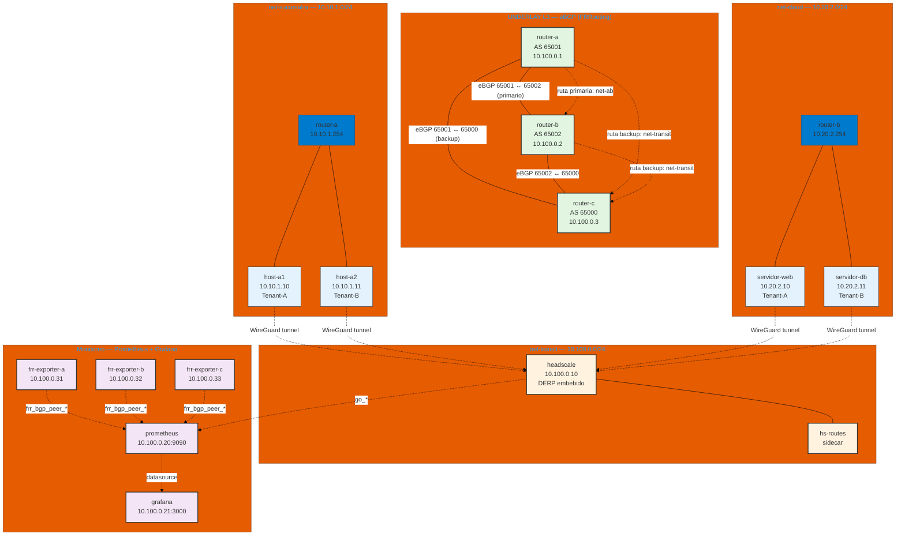

# Diagrama de Topología — TP4 GOYS

> Arquitectura del laboratorio: Mesh VPN Multi-Tenant con Headscale & FRRouting.

## Descripción de segmentos

| Red | CIDR | Propósito |
|-----|------|-----------|
| net-sucursal-a | 10.10.1.0/24 | Sucursal A (host-a1, host-a2, gateway router-a) |
| net-cloud | 10.20.2.0/24 | Sucursal B (servidor-web, servidor-db, gateway router-b) |
| net-transit | 10.100.0.0/24 | Tránsito underlay entre routers y servicios centrales |
| net-ab | 10.100.1.0/24 | Enlace directo primario router-a ↔ router-b |

## Flujo de tráfico clave

1. **Underlay BGP:** router-a y router-b forman sesión eBGP directa por `net-ab` (camino primario). Ambas forman sesión con router-c por `net-transit` (camino de respaldo). Fallback real ante caída de `net-ab`.
2. **Overlay WireGuard:** los 4 nodos finales se registran en Headscale y crean túneles cifrados entre sí. El aislamiento multi-tenant se aplica por ACL en `acl.hujson` (intra-tenant permitido, inter-tenant denegado).
3. **Monitoreo:** `frr_exporter` expone métricas BGP de cada router; Prometheus las scrapea cada 5s; Grafana las visualiza en el dashboard `lab-mesh`.